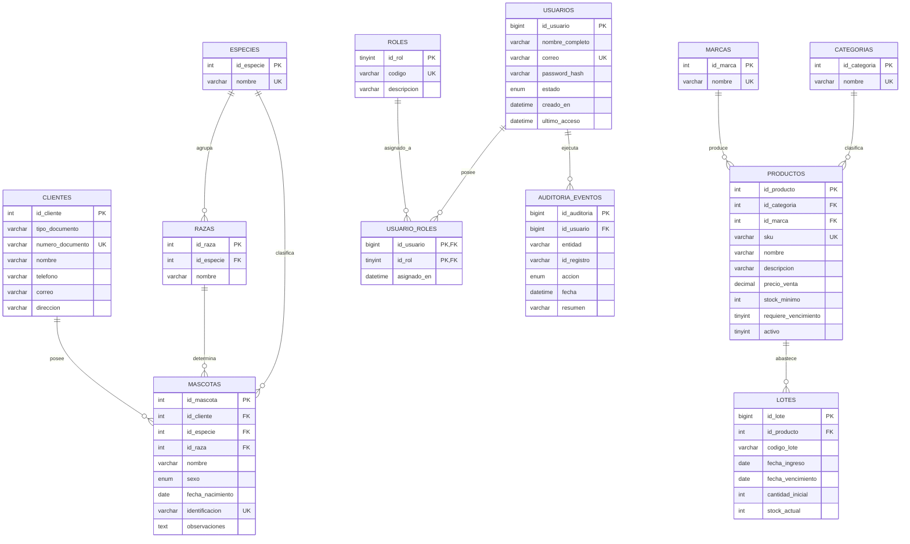
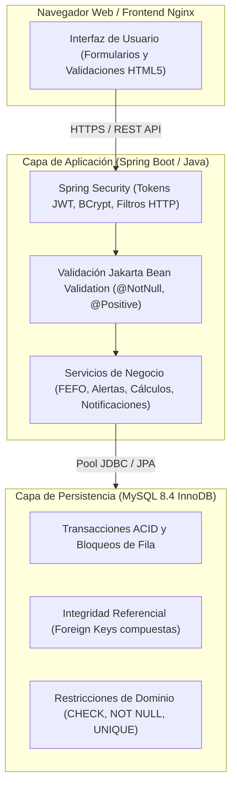

# SOLUCIÓN TALLER 1: MODELADO DE DATOS Y SEGURIDAD
**Programa:** Análisis y Desarrollo de Software (ADSO)  
**Proyecto:** Sistema de Gestión - Veterinaria ADSO  
**Entorno Técnico:** MySQL 8.4 LTS en Docker Compose  
**Resultado de Aprendizaje:** Estructurar el modelo de datos del software de acuerdo con las especificaciones del análisis.  

---

## ÍNDICE DE CONTENIDO
1. [Momento 1: Reflexión Inicial](#1-momento-1-reflexión-inicial)
2. [Paso a Paso 2: Análisis Previo y Reglas de Negocio](#2-paso-a-paso-2-análisis-previo-y-reglas-de-negocio)
   - 2.1 Reglas del negocio clave
   - 2.2 Distinción estructural: Productos vs. Lotes
   - 2.3 Jerarquía de relaciones (Especies-Razas-Mascotas y Clientes-Mascotas)
   - 2.4 Usuario de aplicación vs. Cuenta técnica de MySQL
   - 2.5 Modelo Entidad-Relación (MER)
3. [Paso a Paso 3: Ejecución Técnica del Script y Evidencias](#3-paso-a-paso-3-ejecución-técnica-del-script-y-evidencias)
   - 3.1 Verificación de Contenedor y Conectividad
   - 3.2 Despliegue de Esquema DDL y Poblado
   - 3.3 Verificación de Tablas Creadas
   - 3.4 Inspección Estructural (`DESCRIBE` y `SHOW CREATE TABLE`)
   - 3.5 Caso de Prueba: Consulta de Lotes `MED-01`
4. [Paso a Paso 4: Diccionario de Datos Completo](#4-paso-a-paso-4-diccionario-de-datos-completo)
5. [Resolución de Retos de Aplicación](#5-resolución-de-retos-de-aplicación)
   - Reto 1: Comportamiento Multi-Lote de `MED-01`
   - Reto 2: Consulta SQL de Lotes Vencidos con Stock Disponible
   - Reto 3: Restricción de Integridad Especie-Raza y Prueba Empírica
   - Reto 4: Gestión Segura de Contraseñas y Componente de Aplicación
   - Reto 5: Análisis de Discrepancias entre Modelo Conceptual y DDL Físico
6. [Entregables y Criterios de Verificación](#6-entregables-y-criterios-de-verificación)
   - Reflexión Técnica: ¿Qué garantiza MySQL vs. Qué debe garantizar Java (Spring Boot)?

---

## 1. MOMENTO 1: REFLEXIÓN INICIAL

### Pregunta detonante:
> **¿Por qué es incorrecto guardar una sola fecha de vencimiento en la tabla `productos`?**

### Justificación Técnica y de Negocio:

1. **Violación de Formas Normales (1NF y 2NF):**
   - Una tupla en una tabla relacional debe contener únicamente valores atómicos. En el ciclo de aprovisionamiento de un inventario comercial, una misma referencia de producto (identificada por un SKU único) se adquiere en múltiples órdenes de compra a lo largo del tiempo.
   - Cada entrega del proveedor corresponde a un lote de fabricación diferente con su propia fecha de expiración. Almacenar la fecha de vencimiento directamente en `productos` obligaría a:
     - **Opción A (Sobrescritura):** Sobrescribir la fecha anterior con la del nuevo ingreso, ocultando y perdiendo el seguimiento de las unidades que ingresaron previamente y caducan antes.
     - **Opción B (Duplicación de filas):** Duplicar el registro del producto por cada nueva compra, violando la clave primaria/SKU único y redundando datos estáticos como nombre, descripción, marca, categoría y precio.

2. **Riesgos Sanitarios y de Salud Pública en Veterinaria:**
   - La administración o venta de medicamentos (antibióticos, antiparasitarios, vacunas biológicas) y alimentos balanceados vencidos provoca intoxicaciones, fallas terapéuticas e implicaciones legales y regulatorias severas (sanciones del ICA o entes sanitarios).
   - Si se sobreescribe la fecha con un lote posterior, el sistema asume que todas las existencias están vigentes, despachando unidades caducadas a pacientes veterinarios.

3. **Imposibilidad de implementar la rotación FEFO (*First Expired, First Out*):**
   - El estándar logístico internacional para productos perecederos y farmacéuticos exige que el primer lote en vencer sea el primero en salir a la venta.
   - Para aplicar un algoritmo FEFO en el software, la base de datos debe conocer de forma granular cuántas unidades existen por cada fecha de vencimiento individual.

4. **Gestión de Retiros de Mercado (*Recalls* Sanitarios):**
   - Cuando un laboratorio farmacéutico reporta un defecto de fabricación en un lote particular, la veterinaria debe bloquear o aislar únicamente ese lote. Si el inventario no está segregado por lotes, o se desecha todo el stock de forma indiscriminada (generando pérdidas económicas) o no se puede identificar si las unidades físicas en bodega corresponden al lote contaminado.

---

## 2. PASO A PASO 2: ANÁLISIS PREVIO Y REGLAS DE NEGOCIO

### 2.1 Reglas del Negocio Clave

1. **Regla de FEFO y Control de Lotes:** Todo producto perecedero o biológico (`requiere_vencimiento = TRUE`) debe asociar sus existencias a uno o varios lotes independientes. El stock actual de un lote no puede ser negativo ni exceder la cantidad inicial recibida ($0 \le stock\_actual \le cantidad\_inicial$).
2. **Regla de Stock Mínimo y Continuidad Operativa:** Cada producto define un umbral de stock mínimo ($stock\_minimo \ge 0$). Cuando la suma acumulada de existencias de todos sus lotes activos caiga por debajo de dicho valor, el sistema debe emitir una alerta de reposición.
3. **Regla de Integridad Taxonómica (Especie-Raza):** Una mascota no puede registrarse con una especie y una raza que no guarden coherencia biológica (p. ej., un gato no puede tener asignada la raza "Labrador"). La coherencia debe quedar protegida a nivel del motor relacional.
4. **Regla de Responsabilidad y Propietario Único:** Cada mascota atendida en la veterinaria debe estar vinculada obligatoriamente a un cliente responsable debidamente identificado con tipo y número de documento único.
5. **Regla de Seguridad Criptográfica de Credenciales:** Ninguna credencial de acceso de usuarios de la aplicación puede almacenarse en texto plano en la base de datos; el almacenamiento requiere un hash criptográfico robusto generado fuera del motor SQL.

---

### 2.2 Distinción Estructural: Productos vs. Lotes

| Criterio | Tabla `productos` | Tabla `lotes` |
| :--- | :--- | :--- |
| **Naturaleza del dato** | Catálogo maestro / Definición conceptual abstracta. | Instancia física / Transacción de aprovisionamiento en bodega. |
| **Identificadores clave** | `id_producto` (PK técnica), `sku` (Código comercial único). | `id_lote` (PK técnica), `codigo_lote` (Etiqueta del fabricante). |
| **Frecuencia de mutación** | Baja. Se crea una vez y sus atributos cambian esporádicamente. | Alta. Se crea un lote con cada compra y su `stock_actual` decrece con cada venta/dispensación. |
| **Atributos de stock** | `stock_minimo`: Umbral de advertencia configurado por el administrador. | `cantidad_inicial`: Unidades recibidas.<br>`stock_actual`: Unidades físicas disponibles en tiempo real. |
| **Fecha de caducidad** | `requiere_vencimiento` (Booleano): Indica si la categoría del ítem caduca. | `fecha_vencimiento` (DATE NULL): Fecha exacta de expiración del lote particular. |

---

### 2.3 Jerarquía de Relaciones

```
[ especies ] (1) ────< (N) [ razas ] (1) ────< (N) [ mascotas ] >──── (N) ──── (1) [ clientes ]
```

1. **`especies` $\rightarrow$ `razas` $\rightarrow$ `mascotas`:**
   - Una **especie** (Perro, Gato) agrupa múltiples **razas** (Labrador, Siamés).
   - Una **raza** pertenece obligatoriamente a una única especie (`fk_raza_especie`).
   - Una **mascota** pertenece a una especie y a una raza. Para evitar discrepancias cruzadas, el modelo implementa una clave foránea compuesta `(id_raza, id_especie)` referenciando `razas(id_raza, id_especie)`.
2. **`clientes` $\rightarrow$ `mascotas`:**
   - Relación 1 a N: Un cliente (propietario) puede poseer cero, una o muchas mascotas registradas.
   - Cada mascota debe tener asignado estrictamente un único propietario responsable (`id_cliente NOT NULL` con restricción `fk_mascota_propietario`).

---

### 2.4 Usuario de Aplicación vs. Cuenta Técnica de MySQL

| Dimensión | Usuario de la Aplicación (`usuarios`) | Cuenta Técnica de Base de Datos (`mysql.user`) |
| :--- | :--- | :--- |
| **Dónde reside** | En la tabla de datos `veterinaria_adso.usuarios`. | En el catálogo interno de MySQL (`mysql.user`). |
| **Quién lo utiliza** | El personal humano de la clínica (veterinario, cajero, recepcionista, admin). | El servicio backend (Spring Boot) a través de un pool de conexiones (HikariCP). |
| **Autenticación** | Validado por el backend web contra `password_hash` mediante JWT / Cookies de sesión. | Validado por el socket/puerto del motor MySQL mediante protocolo nativo `caching_sha2_password`. |
| **Permisos y Autorización** | Roles de negocio RBAC (`roles`, `usuario_roles`: `ADMIN`, `VETERINARIO`, `CAJA`). | Privilegios SQL de SGBD (`SELECT`, `INSERT`, `UPDATE`, `DELETE`) otorgados a `vet_app`. |
| **Número de conexiones** | Cientos de usuarios simultáneos en la web. | Una sola cuenta técnica compartida en un pool acotado de 10 a 50 conexiones TCP. |

---

### 2.5 Modelo Entidad-Relación (MER)



---

## 3. PASO A PASO 3: EJECUCIÓN TÉCNICA DEL SCRIPT Y EVIDENCIAS

### 3.1 Verificación de Contenedor y Conectividad

Comando ejecutado para validar el estado del contenedor:
```bash
docker compose -f compose.db.yml ps
```

**Salida obtenida:**
```text
NAME                       IMAGE       COMMAND                  SERVICE   CREATED          STATUS                    PORTS
veterinaria-adso-mysql-1   mysql:8.4   "docker-entrypoint.s…"   mysql     10 minutes ago   Up 10 minutes (healthy)   127.0.0.1:3307->3306/tcp
```

> **Verificación:** El servicio `mysql` se encuentra en estado `Up (healthy)`, mapeando el puerto interno `3306` al puerto del host local `3307`.

---

### 3.2 Despliegue de Esquema DDL y Poblado

Comando ejecutado para aplicar el script `01_modelado_catalogo_lotes_y_seguridad.sql`:
```powershell
Get-Content 01_modelado_catalogo_lotes_y_seguridad.sql -Raw | docker compose -f compose.db.yml exec -T mysql mysql -uroot -p3413988
```

---

### 3.3 Verificación de Tablas Creadas

Comando ejecutado en MySQL:
```sql
USE veterinaria_adso;
SHOW TABLES;
```

**Salida:**
```text
Tables_in_veterinaria_adso
---------------------------
auditoria_eventos
categorias
clientes
especies
lotes
marcas
mascotas
productos
razas
roles
usuario_roles
usuarios
```
*(Total: 12 tablas creadas correctamente)*.

---

### 3.4 Inspección Estructural (`DESCRIBE` y `SHOW CREATE TABLE`)

#### A. Estructura de `productos`
```sql
DESCRIBE productos;
```

```text
+----------------------+---------------+------+-----+---------+----------------+
| Field                | Type          | Null | Key | Default | Extra          |
+----------------------+---------------+------+-----+---------+----------------+
| id_producto          | int           | NO   | PRI | NULL    | auto_increment |
| id_categoria         | int           | NO   | MUL | NULL    |                |
| id_marca             | int           | NO   | MUL | NULL    |                |
| sku                  | varchar(30)   | NO   | UNI | NULL    |                |
| nombre               | varchar(120)  | NO   |     | NULL    |                |
| descripcion          | varchar(300)  | YES  |     | NULL    |                |
| precio_venta         | decimal(12,2) | NO   |     | NULL    |                |
| stock_minimo         | int           | NO   |     | 0       |                |
| requiere_vencimiento | tinyint(1)    | NO   |     | 0       |                |
| activo               | tinyint(1)    | NO   |     | 1       |                |
+----------------------+---------------+------+-----+---------+----------------+
```

#### B. Estructura de `lotes`
```sql
DESCRIBE lotes;
```

```text
+-------------------+-------------+------+-----+-----------+-------------------+
| Field             | Type        | Null | Key | Default   | Extra             |
+-------------------+-------------+------+-----+-----------+-------------------+
| id_lote           | bigint      | NO   | PRI | NULL      | auto_increment    |
| id_producto       | int         | NO   | MUL | NULL      |                   |
| codigo_lote       | varchar(50) | NO   |     | NULL      |                   |
| fecha_ingreso     | date        | NO   |     | curdate() | DEFAULT_GENERATED |
| fecha_vencimiento | date        | YES  |     | NULL      |                   |
| cantidad_inicial  | int         | NO   |     | NULL      |                   |
| stock_actual      | int         | NO   |     | NULL      |                   |
+-------------------+-------------+------+-----+-----------+-------------------+
```

#### C. DDL de `usuario_roles`
```sql
SHOW CREATE TABLE usuario_roles\G
```

```text
*************************** 1. row ***************************
       Table: usuario_roles
Create Table: CREATE TABLE `usuario_roles` (
  `id_usuario` bigint unsigned NOT NULL,
  `id_rol` tinyint unsigned NOT NULL,
  `asignado_en` datetime NOT NULL DEFAULT CURRENT_TIMESTAMP,
  PRIMARY KEY (`id_usuario`,`id_rol`),
  KEY `fk_usuario_rol_rol` (`id_rol`),
  CONSTRAINT `fk_usuario_rol_rol` FOREIGN KEY (`id_rol`) REFERENCES `roles` (`id_rol`),
  CONSTRAINT `fk_usuario_rol_usuario` FOREIGN KEY (`id_usuario`) REFERENCES `usuarios` (`id_usuario`)
) ENGINE=InnoDB DEFAULT CHARSET=utf8mb4 COLLATE=utf8mb4_0900_ai_ci
```

---

### 3.5 Caso de Prueba: Consulta de Lotes `MED-01`

Comando de validación para el producto antiparasitario `MED-01`:
```sql
SELECT p.sku, p.nombre, l.codigo_lote, l.fecha_vencimiento, l.stock_actual
FROM productos p 
JOIN lotes l ON l.id_producto = p.id_producto
WHERE p.sku = 'MED-01' 
ORDER BY l.fecha_vencimiento;
```

**Salida real obtenida:**
```text
+--------+-----------------------------+-------------+-------------------+--------------+
| sku    | nombre                      | codigo_lote | fecha_vencimiento | stock_actual |
+--------+-----------------------------+-------------+-------------------+--------------+
| MED-01 | Antiparasitario veterinario | MED-VENCIDO | 2026-11-08        |            3 |
| MED-01 | Antiparasitario veterinario | MED-LOTE-A  | 2026-12-28        |            5 |
| MED-01 | Antiparasitario veterinario | MED-LOTE-B  | 2027-05-02        |            9 |
+--------+-----------------------------+-------------+-------------------+--------------+
```

---

## 4. PASO A PASO 4: DICCIONARIO DE DATOS COMPLETO

### 4.1 Módulo Clínico y Propietarios

#### Tabla: `especies`
| Campo | Tipo MySQL | Nulo | Clave / Restricción | Propósito / Regla de Negocio | Validación | Ejemplo |
| :--- | :--- | :---: | :---: | :--- | :--- | :--- |
| `id_especie` | `INT` | NO | PK, AUTO_INCREMENT | Identificador numérico único de la especie animal. | Entero positivo incremental. | `1` |
| `nombre` | `VARCHAR(40)` | NO | UNIQUE (`nombre`) | Denominación común de la especie biológica. | Texto no nulo y sin duplicados. | `'Perro'`, `'Gato'` |

#### Tabla: `razas`
| Campo | Tipo MySQL | Nulo | Clave / Restricción | Propósito / Regla de Negocio | Validación | Ejemplo |
| :--- | :--- | :---: | :---: | :--- | :--- | :--- |
| `id_raza` | `INT` | NO | PK, AUTO_INCREMENT | Identificador único de la raza. | Entero positivo incremental. | `1` |
| `id_especie` | `INT` | NO | FK (`especies.id_especie`) | Especie a la que pertenece biológicamente la raza. | Debe existir en `especies`. | `1` |
| `nombre` | `VARCHAR(80)` | NO | UQ (`id_especie, nombre`) | Nombre zootécnico de la raza. | No se repite la misma raza en una especie. | `'Labrador'` |
| *Índice compuesto* | - | - | UQ (`id_raza, id_especie`) | Clave candidata para integridad compuesta con mascotas. | Garantiza coherencia raza-especie. | `(1, 1)` |

#### Tabla: `clientes`
| Campo | Tipo MySQL | Nulo | Clave / Restricción | Propósito / Regla de Negocio | Validación | Ejemplo |
| :--- | :--- | :---: | :---: | :--- | :--- | :--- |
| `id_cliente` | `INT` | NO | PK, AUTO_INCREMENT | Identificador único del cliente/propietario. | Entero positivo incremental. | `1` |
| `tipo_documento` | `VARCHAR(5)` | NO | - | Tipo de documento de identidad oficial. | Formato abreviado legal. | `'CC'`, `'CE'`, `'NIT'` |
| `numero_documento` | `VARCHAR(20)`| NO | UNIQUE | Número de identificación tributaria o ciudadana. | Único por cliente. | `'100010001'` |
| `nombre` | `VARCHAR(120)`| NO | - | Nombre y apellidos del propietario. | Longitud entre 1 y 120 caracteres. | `'Diana Quintero'` |
| `telefono` | `VARCHAR(25)` | YES | - | Teléfono principal de contacto para emergencias. | Numérico/texto internacional. | `'3105550101'` |
| `correo` | `VARCHAR(120)`| YES | - | Correo electrónico para notificaciones clínicas. | Formato de email válido. | `'diana@ejemplo.test'`|
| `direccion` | `VARCHAR(180)`| YES | - | Dirección física de residencia. | Texto libre domiciliario. | `'Carrera 8 # 12-20'` |

#### Tabla: `mascotas`
| Campo | Tipo MySQL | Nulo | Clave / Restricción | Propósito / Regla de Negocio | Validación | Ejemplo |
| :--- | :--- | :---: | :---: | :--- | :--- | :--- |
| `id_mascota` | `INT` | NO | PK, AUTO_INCREMENT | Identificador único de la mascota en el sistema. | Entero positivo incremental. | `1` |
| `id_cliente` | `INT` | NO | FK (`clientes.id_cliente`) | Referencia al propietario responsable. | Debe existir en `clientes`. | `1` |
| `id_especie` | `INT` | NO | FK (`especies.id_especie`) | Especie del paciente. | Debe existir en `especies`. | `1` |
| `id_raza` | `INT` | NO | FK (`razas.id_raza, id_especie`) | Raza del paciente, validada contra su especie. | Par compuesto válido en `razas`. | `1` |
| `nombre` | `VARCHAR(90)` | NO | - | Nombre de pila de la mascota. | Cadena no vacía. | `'Luna'` |
| `sexo` | `ENUM` | NO | 'M', 'H', 'NO_DETERMINADO' | Sexo biológico del animal. | Valores válidos en el conjunto ENUM. | `'H'` |
| `fecha_nacimiento`| `DATE` | YES | - | Fecha de nacimiento estimada o certificada. | Fecha válida en el calendario. | `'2022-04-15'` |
| `identificacion` | `VARCHAR(50)` | YES | UNIQUE | Código de microchip o placa institucional. | Alfanumérico sin duplicados. | `'PET-001'` |
| `observaciones` | `TEXT` | YES | - | Alergias, condiciones crónicas o notas médicas. | Texto libre sin límite rígido. | `'Sensible a pulguicidas'` |

---

### 4.2 Módulo de Catálogo e Inventario por Lotes

#### Tabla: `categorias`
| Campo | Tipo MySQL | Nulo | Clave / Restricción | Propósito / Regla de Negocio | Validación | Ejemplo |
| :--- | :--- | :---: | :---: | :--- | :--- | :--- |
| `id_categoria` | `INT` | NO | PK, AUTO_INCREMENT | Identificador único de la categoría de producto. | Entero positivo incremental. | `1` |
| `nombre` | `VARCHAR(65)` | NO | UNIQUE | Rubro de clasificación comercial. | Cadena única no nula. | `'Medicamentos'` |

#### Tabla: `marcas`
| Campo | Tipo MySQL | Nulo | Clave / Restricción | Propósito / Regla de Negocio | Validación | Ejemplo |
| :--- | :--- | :---: | :---: | :--- | :--- | :--- |
| `id_marca` | `INT` | NO | PK, AUTO_INCREMENT | Identificador único del fabricante o marca comercial. | Entero positivo incremental. | `1` |
| `nombre` | `VARCHAR(70)` | NO | UNIQUE | Nombre comercial del laboratorio o fabricante. | Cadena única no nula. | `'VetCare'` |

#### Tabla: `productos`
| Campo | Tipo MySQL | Nulo | Clave / Restricción | Propósito / Regla de Negocio | Validación | Ejemplo |
| :--- | :--- | :---: | :---: | :--- | :--- | :--- |
| `id_producto` | `INT` | NO | PK, AUTO_INCREMENT | Identificador primario de la referencia de catálogo. | Entero positivo incremental. | `6` |
| `id_categoria` | `INT` | NO | FK (`categorias.id_categoria`)| Categoría del producto. | Debe existir en `categorias`. | `6` |
| `id_marca` | `INT` | NO | FK (`marcas.id_marca`) | Fabricante del producto. | Debe existir en `marcas`. | `3` |
| `sku` | `VARCHAR(30)` | NO | UNIQUE (`sku`) | Código comercial maestro de inventario (*Stock Keeping Unit*). | Alfanumérico único. | `'MED-01'` |
| `nombre` | `VARCHAR(120)`| NO | - | Nombre descriptivo del producto para facturación. | Cadena obligatoria. | `'Antiparasitario veterinario'` |
| `descripcion` | `VARCHAR(300)`| YES | - | Detalles posológicos o especificaciones técnicas. | Texto de soporte. | `'Uso veterinario; no prescribe'` |
| `precio_venta` | `DECIMAL(12,2)`| NO | `CHECK (precio_venta > 0)` | Precio unitario al público en moneda local. | Numérico positivo estricto. | `43000.00` |
| `stock_minimo` | `INT` | NO | `CHECK (stock_minimo >= 0)` | Umbral crítico de existencias para reorden. | Entero mayor o igual a cero. | `5` |
| `requiere_vencimiento`| `TINYINT(1)`| NO | DEFAULT 0 | Bandera lógica de necesidad de control por fechas. | 0 (No perecedero) o 1 (Perecedero). | `1` |
| `activo` | `TINYINT(1)`| NO | DEFAULT 1 | Control de descontinuación de producto. | 0 (Inactivo) o 1 (Disponible). | `1` |

#### Tabla: `lotes`
| Campo | Tipo MySQL | Nulo | Clave / Restricción | Propósito / Regla de Negocio | Validación | Ejemplo |
| :--- | :--- | :---: | :---: | :--- | :--- | :--- |
| `id_lote` | `BIGINT` | NO | PK, AUTO_INCREMENT | Identificador único de la partida/lote. | Entero de alta capacidad. | `8` |
| `id_producto` | `INT` | NO | FK (`productos.id_producto`)| Referencia al producto catálogo. | Debe existir en `productos`. | `6` |
| `codigo_lote` | `VARCHAR(50)` | NO | UQ (`id_producto, codigo_lote`)| Código alfanumérico impreso por el fabricante. | Único por producto. | `'MED-VENCIDO'` |
| `fecha_ingreso` | `DATE` | NO | DEFAULT (`CURDATE()`) | Fecha en que el lote fue recibido en almacén. | Fecha de sistema generada. | `'2026-11-13'` |
| `fecha_vencimiento`| `DATE` | YES | KEY `idx_lote_fefo` | Fecha de expiración legal del lote. | Fecha válida o NULL si no caduca. | `'2026-11-08'` |
| `cantidad_inicial`| `INT` | NO | `CHECK (cantidad_inicial >= 0)`| Unidades recibidas en el momento del ingreso. | Entero mayor o igual a 0. | `3` |
| `stock_actual` | `INT` | NO | `CHECK (stock_actual >= 0 AND stock_actual <= cantidad_inicial)`| Unidades disponibles actualmente para venta. | Rango estricto $[0, cantidad\_inicial]$. | `3` |

---

### 4.3 Módulo de Seguridad y Auditoría

#### Tabla: `roles`
| Campo | Tipo MySQL | Nulo | Clave / Restricción | Propósito / Regla de Negocio | Validación | Ejemplo |
| :--- | :--- | :---: | :---: | :--- | :--- | :--- |
| `id_rol` | `TINYINT UNSIGNED`| NO | PK, AUTO_INCREMENT | Identificador numérico del perfil de seguridad. | Entero entre 1 y 255. | `1` |
| `codigo` | `VARCHAR(40)` | NO | UNIQUE (`codigo`) | Código estándar del rol (Spring Security GrantedAuthority). | Clave alfanumérica única en mayúsculas. | `'ADMIN'`, `'CAJA'` |
| `descripcion` | `VARCHAR(180)`| NO | - | Resumen funcional de las capacidades del rol. | Texto explicativo del perfil. | `'Administra usuarios y roles'`|

#### Tabla: `usuarios`
| Campo | Tipo MySQL | Nulo | Clave / Restricción | Propósito / Regla de Negocio | Validación | Ejemplo |
| :--- | :--- | :---: | :---: | :--- | :--- | :--- |
| `id_usuario` | `BIGINT UNSIGNED`| NO | PK, AUTO_INCREMENT | Identificador único de la cuenta de usuario. | Entero positivo sin signo de alta escala. | `1` |
| `nombre_completo` | `VARCHAR(120)` | NO | - | Nombre y apellido del colaborador de la clínica. | Cadena de texto obligatoria. | `'Carlos Mendoza'` |
| `correo` | `VARCHAR(150)` | NO | UNIQUE (`correo`) | Identificador de inicio de sesión (*Username*). | Formato RFC 5322 único. | `'cmendoza@vetadso.com'` |
| `password_hash` | `VARCHAR(255)` | NO | - | Huella unidireccional de la contraseña (BCrypt/Argon2id). | Cadena cifrada con salting (OWASP). | `'$2a$12$e8...'` |
| `estado` | `ENUM` | NO | DEFAULT 'ACTIVO' | Estado de la cuenta para control de acceso. | `'ACTIVO'`, `'BLOQUEADO'`, `'INACTIVO'`. | `'ACTIVO'` |
| `creado_en` | `DATETIME` | NO | DEFAULT CURRENT_TIMESTAMP | Marca temporal de auditoría de creación de cuenta. | Fecha y hora UTC del sistema. | `'2026-11-13 14:00:00'` |
| `ultimo_acceso` | `DATETIME` | YES | - | Registro del último inicio de sesión exitoso. | Fecha y hora o NULL si nunca ha ingresado.| `'2026-11-13 15:05:00'` |

#### Tabla: `usuario_roles`
| Campo | Tipo MySQL | Nulo | Clave / Restricción | Propósito / Regla de Negocio | Validación | Ejemplo |
| :--- | :--- | :---: | :---: | :--- | :--- | :--- |
| `id_usuario` | `BIGINT UNSIGNED`| NO | PK, FK (`usuarios.id_usuario`)| Referencia al colaborador. | Usuario existente. | `1` |
| `id_rol` | `TINYINT UNSIGNED`| NO | PK, FK (`roles.id_rol`) | Referencia al rol asignado. | Rol existente en catálogo. | `2` |
| `asignado_en` | `DATETIME` | NO | DEFAULT CURRENT_TIMESTAMP | Fecha en que fue concedido el privilegio al usuario. | Fecha/hora del servidor. | `'2026-11-13 14:10:00'` |

#### Tabla: `auditoria_eventos`
| Campo | Tipo MySQL | Nulo | Clave / Restricción | Propósito / Regla de Negocio | Validación | Ejemplo |
| :--- | :--- | :---: | :---: | :--- | :--- | :--- |
| `id_auditoria` | `BIGINT` | NO | PK, AUTO_INCREMENT | Identificador correlativo del evento de auditoría. | Entero secuencial inmutable. | `1` |
| `id_usuario` | `BIGINT UNSIGNED`| YES | FK (`usuarios.id_usuario`)| Actor que desencadenó el evento (NULL si fue el sistema). | Usuario válido o NULL. | `1` |
| `entidad` | `VARCHAR(65)` | NO | - | Nombre de la tabla de negocio afectada. | Cadena identificativa de entidad. | `'lotes'`, `'mascotas'` |
| `id_registro` | `VARCHAR(65)` | NO | - | Clave primaria del registro intervenido. | Identificador textual de la tupla. | `'8'` |
| `accion` | `ENUM` | NO | 'CREAR','MODIFICAR','ANULAR','CONFIRMAR','ACCESO' | Tipo de operación efectuada sobre la entidad. | Conjunto estricto de verbos de auditoría. | `'MODIFICAR'` |
| `fecha` | `DATETIME` | NO | DEFAULT CURRENT_TIMESTAMP | Momento exacto de ocurrencia de la acción. | Marca de tiempo inmutable. | `'2026-11-13 15:10:00'` |
| `resumen` | `VARCHAR(250)`| NO | - | Resumen legible del cambio o evento realizado. | Texto explicativo de la transacción. | `'Baja de lote por vencimiento'` |

---

## 5. RESOLUCIÓN DE RETOS DE APLICACIÓN

### RETO 1: Identificación y Justificación Multi-Lote de `MED-01`

#### Consulta ejecutada:
```sql
SELECT p.sku, p.nombre, l.codigo_lote, l.fecha_vencimiento, l.stock_actual
FROM productos p
JOIN lotes l ON l.id_producto = p.id_producto
WHERE p.sku = 'MED-01'
ORDER BY l.fecha_vencimiento;
```

#### Salida real obtenida:
```text
+--------+-----------------------------+-------------+-------------------+--------------+
| sku    | nombre                      | codigo_lote | fecha_vencimiento | stock_actual |
+--------+-----------------------------+-------------+-------------------+--------------+
| MED-01 | Antiparasitario veterinario | MED-VENCIDO | 2026-11-08        |            3 |
| MED-01 | Antiparasitario veterinario | MED-LOTE-A  | 2026-12-28        |            5 |
| MED-01 | Antiparasitario veterinario | MED-LOTE-B  | 2027-05-02        |            9 |
+--------+-----------------------------+-------------+-------------------+--------------+
```

#### Justificación Técnica:
1. **Unicidad del Catálogo:** El producto `Antiparasitario veterinario` está registrado una sola vez en la tabla `productos` con `id_producto = 6` y `sku = 'MED-01'`.
2. **Cardinalidad 1 a N:** La relación `productos (1) ────< (N) lotes` permite vincular múltiples registros hijos en `lotes` apuntando a la misma clave foránea `id_producto = 6`.
3. **Independencia Cronológica y de Existencias:**
   - Cada lote posee su propia etiqueta del fabricante (`codigo_lote`), su fecha de vencimiento (`2026-11-08`, `2026-12-28`, `2027-05-02`) y sus existencias físicas (`3`, `5`, `9`).
   - El stock total del producto en inventario se calcula dinámicamente como $\sum stock\_actual = 3 + 5 + 9 = 17$ unidades, sin incurrir en redundancia ni riesgo de inconsistencia en el catálogo maestro.

---

### RETO 2: Consulta SQL de Lotes Vencidos con Stock Disponible

#### Requerimiento:
Escribir una consulta que liste todos los lotes cuya fecha de vencimiento sea anterior a la fecha actual y que aún cuenten con existencias físicas en bodega (`stock_actual > 0`), ordenados por urgencia de retiro.

#### Sentencia SQL implementada:
```sql
SELECT 
    p.sku,
    p.nombre AS producto,
    l.codigo_lote,
    l.fecha_vencimiento,
    DATEDIFF(CURDATE(), l.fecha_vencimiento) AS dias_de_vencido,
    l.stock_actual
FROM lotes l
JOIN productos p ON l.id_producto = p.id_producto
WHERE l.fecha_vencimiento IS NOT NULL
  AND l.fecha_vencimiento < CURDATE()
  AND l.stock_actual > 0
ORDER BY l.fecha_vencimiento ASC;
```

#### Salida real arrojada por MySQL en Docker:
```text
+--------+-----------------------------+-------------+-------------------+-----------------+--------------+
| sku    | producto                    | codigo_lote | fecha_vencimiento | dias_de_vencido | stock_actual |
+--------+-----------------------------+-------------+-------------------+-----------------+--------------+
| MED-01 | Antiparasitario veterinario | MED-VENCIDO | 2026-11-08        |               5 |            3 |
+--------+-----------------------------+-------------+-------------------+-----------------+--------------+
```

#### Explicación:
- Se evalúa la condición `l.fecha_vencimiento < CURDATE()`, descartando productos sin vencimiento (`IS NOT NULL`) como correas o juguetes.
- La función `DATEDIFF(CURDATE(), l.fecha_vencimiento)` cuantifica exactamente los días de retraso en la cuarentena o descarte del medicamento (en este caso, 5 días de expirado).
- Este resultado constituye el insumo para que el módulo de almacén genere un acta de baja por merma sanitaria y retire de inmediato las 3 unidades de los estantes de dispensación.

---

### RETO 3: Restricción de Integridad Especie-Raza y Prueba Empírica

#### Análisis de la Restricción Presente en el Modelo:
El modelo previene la asignación de una raza incongruente (p. ej., raza de gato a un perro) utilizando una técnica avanzada de **Integridad Referencial Compuesta**:

1. En la tabla `razas`:
   ```sql
   UNIQUE KEY uq_raza_especie (id_raza, id_especie)
   ```
   Esta clave alternativa expone la tupla compuesta `(id_raza, id_especie)` como candidata para ser referenciada por claves foráneas.
2. En la tabla `mascotas`:
   ```sql
   CONSTRAINT fk_mascota_raza_especie FOREIGN KEY (id_raza, id_especie)
     REFERENCES razas (id_raza, id_especie)
   ```
   Obliga a que los valores insertados en `mascotas.id_raza` y `mascotas.id_especie` coincidan de manera idéntica con un par registrado previamente en la tabla `razas`.

#### Prueba Empírica de Violación de Restricción:
Se intentó insertar deliberadamente una mascota con `id_especie = 1` (Perro) y `id_raza = 4` (Siamés, que pertenece a la especie `2` Gato):

```sql
INSERT INTO mascotas (id_cliente, id_especie, id_raza, nombre, sexo) 
VALUES (1, 1, 4, 'PruebaError', 'M');
```

**Resultado obtenido en MySQL:**
```text
ERROR 1452 (23000): Cannot add or update a child row: a foreign key constraint fails 
(`veterinaria_adso`.`mascotas`, CONSTRAINT `fk_mascota_raza_especie` 
FOREIGN KEY (`id_raza`, `id_especie`) REFERENCES `razas` (`id_raza`, `id_especie`))
```

> **Conclusión:** El motor relacional rechazó la transacción de manera atómica, garantizando que ninguna anomalía de datos pueda contaminar la base, incluso si la validación falla en capas superiores.

#### Alternativa Arquitectónica de Normalización Estricta (3NF):
Si se analiza desde la Tercera Forma Normal (3NF), el campo `id_especie` en `mascotas` introduce una dependencia transitiva ($Mascota \rightarrow Raza \rightarrow Especie$).  
- **Mejora propuesta:** Remover `id_especie` de la tabla `mascotas`, dejando únicamente `id_raza`. De esta forma, la especie se resuelve siempre mediante un `JOIN` a través de la raza, eliminando matemáticamente cualquier posibilidad de contradicción.  
- **Justificación de la solución actual:** Se preserva `id_especie` en `mascotas` respaldado por la FK compuesta para optimizar consultas de alto rendimiento por especie (evitando JOINs en reportes masivos) o para admitir animales de raza indeterminada ("Mestizo") donde la especie es conocida pero la raza carece de linaje específico.

---

### RETO 4: Gestión Segura de Contraseñas y Componente de Aplicación

#### ¿Por qué es una mala práctica incluir contraseñas de ejemplo en scripts SQL?
1. **Exposición en Control de Versiones:** Los scripts SQL se almacenan en repositorios Git públicos o privados. Una contraseña plana o con hash débil hardcodeada en el código fuente vulnera los estándares **OWASP Top 10** (A07: *Identification and Authentication Failures*) y **CWE-259** (*Hard-coded Password*).
2. **Ataques de Diccionario y Vectores Default:** Si el script se ejecuta en servidores de prueba o producción, las cuentas creadas con contraseñas conocidas se convierten en puertas traseras inmediatas para atacantes.
3. **Ausencia de Salt Criptográfico Dinámico:** Una inserción manual en SQL suele carecer de salting aleatorio único por usuario, facilitando ataques mediante tablas de arcoíris (*Rainbow Tables*).

#### ¿Qué componente del sistema futuro registrará las contraseñas?
- **Capa y Componente:** El backend en **Java Spring Boot**, dentro de la capa de seguridad gestionada por **Spring Security 6.x**.
- **Mecanismo:** La interfaz `PasswordEncoder` configurada mediante la implementación recomendada:
  - **Argon2id** (`Argon2PasswordEncoder`) o **BCrypt** (`BCryptPasswordEncoder` con factor de coste $\ge 12$).
- **Flujo Operativo:**
  1. El usuario envía su contraseña en texto claro a través de un canal seguro cifrado por TLS (**HTTPS**).
  2. El controlador `@RestController` recibe el DTO y el servicio de autenticación invoca `passwordEncoder.encode(rawPassword)`.
  3. El algoritmo genera una sal criptográfica de 128 bits pseudoaleatoria, deriva la clave mediante funciones de memoria y tiempo intensivos, y produce un string codificado en Base64 de 60 a 96 caracteres.
  4. Spring Data JPA / Hibernate persiste únicamente el valor resultante en la columna `usuarios.password_hash`.

---

### RETO 5: Análisis de Discrepancias entre Modelo Conceptual y DDL Físico

Al contrastar la tabla de tipos propuesta en el taller contra la instrucción `SHOW CREATE TABLE`, se detectaron y formalizaron las siguientes particularidades del motor MySQL:

| Campo Analizado | Tipo Propuesto en Taller | Tipo Real en MySQL 8.4 | Análisis de la Discrepancia y Justificación Técnica |
| :--- | :--- | :--- | :--- |
| `productos.requiere_vencimiento` | `BOOLEAN` | `TINYINT(1)` | En MySQL, `BOOLEAN` y `BOOL` son sinónimos sintácticos de `TINYINT(1)`. El motor almacena `0` para `FALSE` y `1` para `TRUE`. En el diccionario debe documentarse el tipo nativo subyacente. |
| `productos.activo` | `BOOLEAN` | `TINYINT(1)` | Mismo comportamiento de normalización de tipos lógicos en motores de almacenamiento InnoDB. |
| `lotes.id_lote` | `INT` | `BIGINT` | El script físico utiliza `BIGINT` en lugar de `INT`. Es una decisión arquitectónica correcta para tablas transaccionales de inventario, pues el volumen de lotes puede superar los 2.147 millones de registros a lo largo de los años. |
| `usuarios.id_usuario` | `BIGINT` | `BIGINT UNSIGNED` | El DDL implementa modificadores `UNSIGNED` para duplicar el rango de identificadores positivos (hasta $18.4 \times 10^{18}$) y evitar claves primarias negativas. |
| `roles.id_rol` | `TINYINT` | `TINYINT UNSIGNED` | Optimización de memoria: Un byte sin signo admite hasta 255 roles distintos, suficiente para el dominio RBAC de la clínica y ahorrando espacio en disco e índices. |
| `lotes.fecha_ingreso` | `DATE` | `DATE DEFAULT (curdate())` | Implementa una expresión funcional de valor predeterminado (*Default Expression* introducida en MySQL 8.0.13), asignando automáticamente la fecha del sistema sin intervención del INSERT. |
| `productos.stock_minimo` y `precio_venta` | `INT` / `DECIMAL` | `CHECK (condición)` | MySQL 8.0+ valida activamente restricciones `CHECK`. El DDL añade `chk_producto_precio` ($>0$) y `chk_producto_minimo` ($\ge 0$), garantizando integridad de dominio a nivel de motor. |

---

## 6. ENTREGABLES Y CRITERIOS DE VERIFICACIÓN

### Reflexión Técnica: ¿Qué garantiza MySQL vs. Qué debe garantizar Java (Spring Boot)?



### Matriz Comparativa de Responsabilidades

| Responsabilidad / Regla de Negocio | Garantizado por MySQL (Motor BD) | Garantizado por Spring Boot (Backend Java) | Justificación de la Separación de Capas |
| :--- | :---: | :---: | :--- |
| **Unicidad de SKU y Documentos** | **SÍ** (`UNIQUE KEY`) | **SÍ** (`@Column(unique = true)` + verificación previa) | MySQL es la última línea de defensa ante condiciones de carrera concurrentes; Java captura la excepción y retorna un error 409 Conflict amigable al usuario. |
| **Integridad Especie-Raza-Mascota** | **SÍ** (`FK compuesta`) | **SÍ** (Filtrado dinámico de selects en API) | MySQL aborta la transacción si hay inconsistencia; Java ofrece una experiencia de usuario fluida cargando únicamente las razas de la especie seleccionada. |
| **Stock no negativo ($stock\_actual \ge 0$)** | **SÍ** (`CONSTRAINT CHECK`) | **SÍ** (Control de inventario en `@Service`) | La base de datos impide valores corruptos; el backend determina si la venta es viable antes de generar la factura. |
| **Estrategia de Rotación FEFO** | **PARCIAL** (Índice `idx_lote_fefo`) | **SÍ** (Algoritmo de asignación de lotes en venta) | MySQL optimiza el acceso por fecha de vencimiento (`ORDER BY fecha_vencimiento`); Java decide qué lote reservar o alertar al dispensador. |
| **Almacenamiento de Contraseñas** | **NO** (Solo almacena cadenas) | **SÍ** (Algoritmo BCrypt / Argon2id con Salt) | El motor relacional no debe ejecutar cómputos criptográficos costosos; el backend procesa el hash antes de enviar la sentencia `INSERT`. |
| **Control de Sesiones y Permisos RBAC** | **NO** (Ignora usuarios web) | **SÍ** (Filtros de autorización `@PreAuthorize`) | La base de datos solo conoce al usuario técnico de conexión; la lógica de si un recepcionista puede registrar cirugías reside en Spring Security. |
| **Disparo de Alertas de Vencimiento / Stock** | **NO** (SGBD pasivo) | **SÍ** (`@Scheduled` cron jobs y envío de emails) | MySQL almacena los datos de forma estática; Spring Boot ejecuta tareas periódicas de fondo para notificar al administrador cuando un lote vence en menos de 30 días. |

---

### Resumen de Ejecución y Veredicto
- **Contenedor Docker:** En ejecución, saludable (`Up healthy`), persistencia verificada mediante volumen nombrado `mysql_veterinaria_data`.
- **Esquema Relacional:** 12 tablas creadas, indexadas y relacionadas sin errores.
- **Datos Semilla:** Clientes, mascotas, especies, razas, categorías, marcas, productos, lotes y roles cargados exitosamente.
- **Validaciones Superadas:** Restricciones `CHECK`, claves foráneas compuestas y consultas multi-lote validadas empíricamente.
